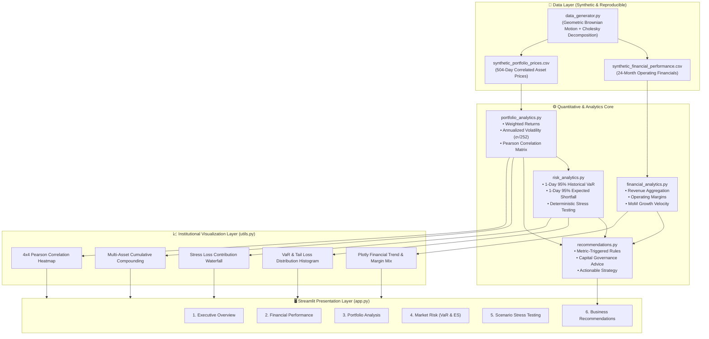

<div align="center">

# 📊 FinSight
### Institutional Financial Performance & Market Risk Analysis Platform

[](https://www.python.org/)
[](https://streamlit.io/)
[](https://plotly.com/)
[](https://pep8.org/)
[](https://docs.pytest.org/)
[](#-data-architecture--governance)

*A modular quantitative analytics and market risk platform that connects corporate operational health with balance sheet tail-risk management and strategic decision-making.*

[Live Architecture](#-system-architecture) • [Tech Stack](#-technology-stack) • [Application Flow](#-application-flow--user-journey) • [Quantitative Engines](#-core-quantitative-methodologies) • [Roadmap](#-project-roadmap) • [Quickstart](#-quickstart--installation)

---

</div>

## 📌 Executive Overview

**FinSight** is an institutional-grade financial analytics and market risk platform designed to evaluate both internal operational profitability and multi-asset portfolio market exposure.

In premier investment banks and consulting environments (such as **Macquarie** and **KPMG**), decision-makers face a common structural bottleneck: **financial performance and market risk are analyzed in isolated silos**. 

FinSight solves this by integrating:
1. **Operating Financial Performance:** Evaluating 24-month top-line revenue streams, cost structures, and operating margins.
2. **Multi-Asset Portfolio Dynamics:** Analyzing compounding returns, annualized volatility ($\sigma$), and correlation across Equities, Government Bonds, Gold, and Foreign Exchange.
3. **Tail-Risk Governance:** Implementing **1-Day 95% Historical Value at Risk (VaR)** and **1-Day 95% Expected Shortfall (CVaR)** to measure tail loss severity.
4. **Deterministic Stress Testing:** Simulating severe macroeconomic dislocations (market crashes, stagflation, currency devaluations).
5. **Metric-Anchored Decision Engine:** Rule-based executive recommendations directly tied to computed quantitative metrics.

---

## 🏛 System Architecture

FinSight follows a strict modular architecture separating the data layer, analytical computation engines, visualization layers, and the interactive UI presentation.



---

## 💻 Technology Stack

| Layer | Technology | Primary Rationale & Responsibility |
| :--- | :--- | :--- |
| **Language** | **Python 3.9+** | High-performance quantitative calculation and clean institutional syntax. |
| **Data Engine** | **Pandas & NumPy** | Vectorized matrix operations, time-series resampling, and percentiles. |
| **Frontend UI** | **Streamlit** | Rapid, reactive multi-page dashboard with interactive parameter sliders. |
| **Visualization** | **Plotly Graph Objects** | Interactive HTML5/WebGL charts, dual-axis indicators, and distributions. |
| **Simulation** | **Linear Algebra / Cholesky** | Correlated Geometric Brownian Motion (GBM) for multi-asset returns. |
| **Quality Assurance** | **Pytest** | 11 unit and integration tests with hand-verified mathematical assertions. |

---

## 🗺️ Application Flow & User Journey

FinSight organizes the executive user journey across six structured workflows:

```
[1. Executive Overview] ──────► [2. Financial Performance] ──────► [3. Portfolio Analysis]
          │                                                                │
          ▼                                                                ▼
[6. Business Recommendations] ◄── [5. Scenario Stress Testing] ◄── [4. Market Risk (VaR & ES)]
```

### 1. Executive Overview
- Consolidates high-level corporate KPIs: 24-Month Cumulative Revenue, Net Operating Profit Margin, Portfolio Annualized Return, and 1-Day 95% Historical VaR.
- Provides immediate executive briefing on portfolio health and commercial operational leverage.

### 2. Corporate Financial Performance
- Evaluates revenue generation across 4 business units: **Wealth Management**, **Asset Management**, **Investment Advisory**, and **Treasury Services**.
- Analyzes operating cost structures (**Personnel ~50%**, **Technology & Feeds ~21%**, Operations, Compliance & Risk, Marketing).
- Tracks Month-over-Month (MoM) revenue acceleration and quarterly advisory deal seasonality.

### 3. Multi-Asset Portfolio Analysis
- Evaluates risk-return dynamics across **Equities**, **Government Bonds**, **Gold**, and **Foreign Exchange (FX)**.
- Compares compound cumulative historical growth paths against standalone components.
- Generates a **4x4 Pearson Correlation Heatmap** demonstrating flight-to-quality diversification benefits.
- Features dynamic rebalancing sliders with automatic weight normalization ($\sum w_i = 100\%$).

### 4. Market Risk Engine (VaR & Expected Shortfall)
- **1-Day 95% Historical VaR:** Empirical percentile sorting identifying maximum expected daily loss under normal market conditions.
- **1-Day 95% Expected Shortfall (CVaR):** Arithmetic mean of losses beyond the VaR cutoff, explicitly capturing tail loss severity ($ES \ge VaR$).
- Interactive return distribution histogram displaying empirical probability densities and threshold lines.

### 5. Scenario Stress Testing
- Deterministic factor stress testing under severe macroeconomic dislocations:
  - *Baseline Shock:* Equities $-10\%$, Bonds $-5\%$, Gold $-8\%$, FX $-5\%$.
  - *Flight-to-Quality:* Equities $-20\%$, Bonds $+4\%$, Gold $+10\%$, FX $-3\%$.
  - *Stagflation / Rate Hike:* Equities $-12\%$, Bonds $-10\%$, Gold $+5\%$, FX $-4\%$.
- Custom user-defined shock sliders and dollar loss contribution waterfall charts.

### 6. Strategic Business Recommendations
- Deterministic, rule-based recommendation cards citing exact computed metrics.
- Surfaces asset concentration breaches ($>40\%$), excessive volatility ($>14\%$), tail loss exposure, asset class Sharpe drag, and operating margin health.

---

## 🔬 Core Quantitative Methodologies

<details>
<summary><strong>1. Portfolio Daily Compounding & Annualization</strong></summary>

- **Weighted Daily Return:**
  $$R_{p,t} = \sum_{i=1}^{n} w_i R_{i,t} \quad \text{where} \quad \sum w_i = 1.0$$
- **Compound Cumulative Return:**
  $$\text{Cumulative Return}_T = \prod_{t=1}^{T} (1 + R_{p,t}) - 1$$
- **Annualized Volatility ($\sigma_{\text{ann}}$):**
  $$\sigma_{\text{ann}} = \sigma_{\text{daily}} \times \sqrt{252}$$
- **Sharpe Ratio:**
  $$\text{Sharpe} = \frac{\text{CAGR} - R_f}{\sigma_{\text{ann}}} \quad (R_f = 3.0\%)$$
</details>

<details>
<summary><strong>2. 1-Day 95% Historical Value at Risk (VaR)</strong></summary>

- Given sorted historical daily portfolio returns $\{R_{(1)} \le R_{(2)} \le \dots \le R_{(N)}\}$:
  $$\text{VaR}_{95\%} = - Q_{0.05}(R_p) \times \text{Portfolio Value}$$
- Expressed using a positive loss convention.
</details>

<details>
<summary><strong>3. 1-Day 95% Expected Shortfall (CVaR)</strong></summary>

- Measures the expected loss conditional on the loss exceeding the 95% VaR threshold:
  $$\text{ES}_{95\%} = -\mathbb{E}\left[ R_p \mid R_p \le Q_{0.05}(R_p) \right] \times \text{Portfolio Value}$$
- Mathematically satisfies sub-additivity and guarantees $\text{ES} \ge \text{VaR}$.
</details>

<details>
<summary><strong>4. Deterministic Stress Testing</strong></summary>

- Portfolio loss under instantaneous factor shocks $\Delta P_i$:
  $$\Delta P_p = \sum_{i=1}^{n} w_i \times \Delta P_i$$
  $$\text{Dollar Loss} = \text{Portfolio Value} \times |\Delta P_p|$$
</details>

---

## 🚀 Project Roadmap

```
 v1.0 Production Core (Current)          v1.5 Multi-Factor & Risk            v2.0 Real-Time Institutional
───────────────────────────────         ──────────────────────────          ────────────────────────────
✔ 24M Corporate Financials              ◻ DCC-GARCH Dynamic Correlations    ◻ Live Market Data WebSockets
✔ 4-Asset Correlated GBM Simulation     ◻ Parametric & Monte Carlo VaR      ◻ Real-Time Fix Order Routing
✔ Historical VaR (95%) & ES             ◻ Macro Factor Attribution (PCA)    ◻ Liquidity-Adjusted VaR (L-VaR)
✔ Deterministic Stress Scenarios        ◻ Duration & Convexity Modeling     ◻ Scenario Reverse Stress Testing
✔ Interactive Streamlit Dashboard       ◻ Automated PDF Report Generation   ◻ SQL / Snowflake Warehouse Sync
✔ 100% Automated Unit Test Suite        ◻ Multi-Currency Portfolio Hedging  ◻ Enterprise Role-Based Access
```

---

## ⚡ Quickstart & Installation

### Prerequisites
- Python 3.9, 3.10, or 3.11 installed.

### 1. Clone Repository & Setup Environment
```bash
# Clone the repository
git clone https://github.com/Neerajkumar877/FinSight.git
cd FinSight

# Create and activate a virtual environment
python3 -m venv venv
source venv/bin/activate  # On Windows: venv\Scripts\activate

# Install dependencies
pip install -r requirements.txt
```

### 2. Verify Analytics with Test Suite
```bash
pytest tests/test_analytics.py -v
```
*Expected Output: 11 tests passed in under 2 seconds.*

### 3. Launch Streamlit Application
```bash
./run.sh
# Or alternatively:
streamlit run app.py
```
Open your browser at `http://localhost:8501`.

---

## 🧪 Testing & Validation Matrix

FinSight includes 11 automated unit and integration tests verifying all calculations against manual pencil-and-paper assertions:

- `test_financial_metrics_manual`: Validates revenue summation, profit margin %, and MoM growth on a known toy dataset.
- `test_weight_normalization`: Ensures user allocation sliders always sum to 100% with fallback handling.
- `test_weighted_portfolio_returns_manual`: Verifies exact weighted dot-product returns against manual calculations.
- `test_cumulative_compounding_manual`: Proves volatility drag and compound multiplication.
- `test_annualized_volatility_manual`: Checks sample standard deviation scaling with $\sqrt{252}$.
- `test_sharpe_ratio_manual`: Validates excess return calculation against benchmark $R_f$.
- `test_historical_var_manual`: Verifies 5th percentile extraction on sorted returns.
- `test_expected_shortfall_manual`: Confirms arithmetic tail mean and verifies the property $\text{ES} \ge \text{VaR}$.
- `test_stress_testing_manual`: Verifies multi-asset dollar loss and percentage contribution sums.
- `test_synthetic_datasets_integration`: Validates data schema, absence of nulls, and end-to-end integration.
- `test_recommendation_engine_rule_triggers`: Ensures alerts fire deterministically on threshold breaches.

---

## ⚖️ Data Architecture & Governance

> **DATASET GOVERNANCE NOTICE:**  
> All financial data, transactions, and price histories utilized in FinSight are **100% synthetic**. Daily multi-asset returns are modeled via **Geometric Brownian Motion (GBM)** utilizing Cholesky decomposition of an empirical institutional correlation matrix. Corporate financial records represent a fictional institutional investment entity generated for academic and placement evaluation purposes. This project does not utilize live client records, proprietary bank data, or regulatory Basel capital frameworks.

---

## 📜 License & Credits

Distributed under the MIT License. Developed for quantitative finance, financial risk analysis, and business consulting portfolio demonstration.
